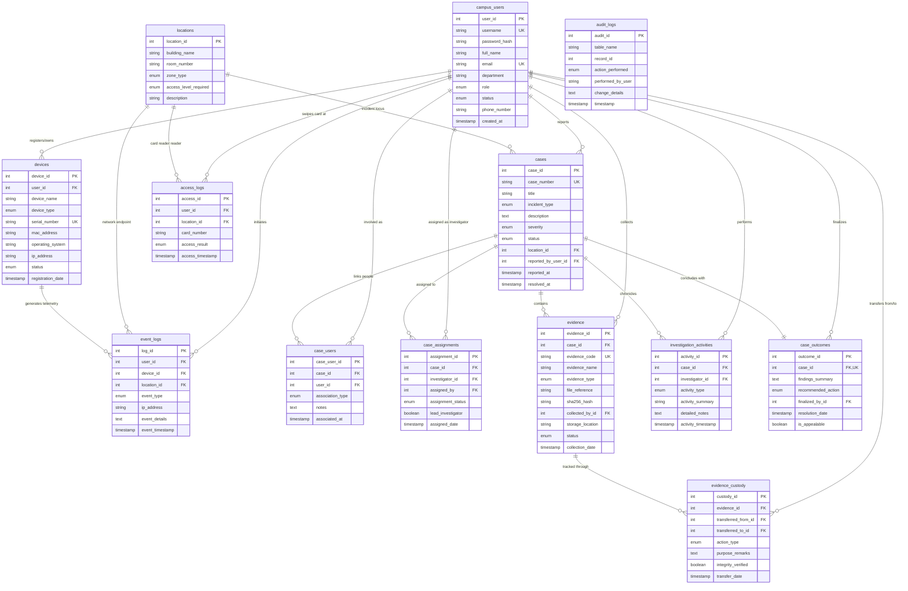

# Campus Digital Forensics System (CDF) - Database Architecture & Schema Specification

## 1. Relational Database Overview
- **Database Engine**: MySQL 8.0+ (InnoDB Storage Engine)
- **Database Name**: `campus_digital_forensics`
- **Character Set**: `utf8mb4`
- **Collation**: `utf8mb4_unicode_ci`
- **ACID Support**: Fully supported via InnoDB Transactions and Row-Level Locking

---

## 2. Entity-Relationship (ER) Diagram

---

## 3. Relational Cardinality & Referential Integrity Summary

| Primary Entity | Child / Associative Entity | Relationship Cardinality | Constraint Behavior | Forensic & Business Purpose |
|---|---|---|---|---|
| `campus_users` | `devices` | 1-to-Many (`1:N`) | `ON DELETE CASCADE` | Associates physical hardware assets to campus account holders. |
| `campus_users` | `case_users` | 1-to-Many (`1:N`) | `ON DELETE CASCADE` | Captures individual roles (Suspect, Victim, Witness, Reporting Party). |
| `cases` | `case_users` | 1-to-Many (`1:N`) | `ON DELETE CASCADE` | Resolves Many-to-Many (`M:N`) between Incidents and Campus Users. |
| `cases` | `case_assignments` | 1-to-Many (`1:N`) | `ON DELETE CASCADE` | Manages investigator casework assignments and lead analyst roles. |
| `cases` | `evidence` | 1-to-Many (`1:N`) | `ON DELETE CASCADE` | Groups all seized digital artifacts under an incident dossier. |
| `evidence` | `evidence_custody` | 1-to-Many (`1:N`) | `ON DELETE CASCADE` | Preserves immutable chronological chain-of-custody transfers. |
| `cases` | `case_outcomes` | 1-to-1 (`1:1`) | `UNIQUE (case_id)` | Enforces exactly one final outcome per completed investigation. |
| `locations` | `cases` | 1-to-Many (`1:N`) | `ON DELETE SET NULL` | Maps incident locus while preserving history if room renumbered. |
| `locations` | `access_logs` | 1-to-Many (`1:N`) | `ON DELETE CASCADE` | Physical card-swipe entry logs across campus facilities. |

---

## 4. Normalization Principles Demonstrated

1. **First Normal Form (1NF)**:
   - All columns contain atomic, indivisible values.
   - Primary keys uniquely identify every row (`user_id`, `device_id`, `case_id`, etc.).
   - No repeating groups or array values stored in columns.

2. **Second Normal Form (2NF)**:
   - All tables are in 1NF.
   - All non-key attributes are fully functionally dependent on the entire primary key (no partial dependencies). In composite bridge tables like `case_users`, attributes depend on the composite key.

3. **Third Normal Form (3NF)**:
   - All tables are in 2NF.
   - Elimination of transitive dependencies ($X \rightarrow Y$ and $Y \rightarrow Z$). For example, user names and emails are not duplicated in `devices` or `cases`; they are normalized in `campus_users` and referenced via Foreign Keys.

4. **Boyce-Codd Normal Form (BCNF)**:
   - Every determinant is a candidate key throughout the normalized schema.
